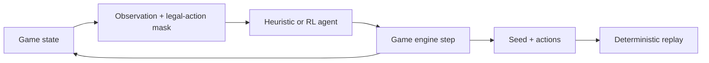

# Flip 7 — Game Engine & Reinforcement Learning Agent

An independent, deterministic implementation of the Flip 7 card game, with pluggable
agents, a Gymnasium training environment, and a trained MaskablePPO policy. One codebase
supports game simulations, policy training, and standalone tournament submissions.

> Independent project; not affiliated with the game's publisher.

## At a glance

- **Game engine:** seeded games for 3–18 players, a step-based API, and exact replay from a seed and action log.
- **Agents:** random and threshold baselines, a depth-2 expectimax heuristic, and an RL agent.
- **Observation model:** public information only; opponents' hands remain hidden.
- **Policy runtime:** NumPy inference with no PyTorch or Stable-Baselines dependency during play.
- **Training:** Gymnasium environment with legal-action masking and a reproducible evaluation pipeline.

## How it works



The four-player RL policy receives a 141-feature observation. Its inputs combine the
player's hand and public cards, opponent summaries, legal targets, a belief estimate of
the hidden draw pile, and endgame features. Training uses MaskablePPO; the exported actor
is stored in `Ergebnisse/rl_actor.npz` and runs through NumPy at tournament time.

## Game model

The engine models the 94-card deck, duplicate-number busts, bonus cards, action cards,
Flip 7 scoring, and the 200-point game target. `Flip7Game.step()` advances one decision
at a time and returns an immutable state view with the legal actions for the acting player.

Agents implement `BaseAgent`, so new strategies can be added without changing the game
loop. A game record stores its seed and action sequence, making completed games replayable
with `flip7.recorder.replay_game`.

## Quick start

Python 3.9 or newer is required.

```bash
git clone https://github.com/Streeti04/Flip7_Agent.git
cd Flip7_Agent
python -m pip install -e '.[dev]'
```

Play a sample game, run the built-in tournament, or test the project:

```bash
python demo.py
python tournament.py
python run_submission_tournament.py
pytest -q
```

To train a new policy, install the optional RL dependencies:

```bash
python -m pip install -e '.[rl]'
python scripts/train_rl.py
```

## Evaluation

Use `scripts/evaluate.py` for seeded comparisons and `scripts/eval_zoo.py` to evaluate
against a broader opponent pool. The tournament tools report mean scores and preserve
seat order and seeds so comparisons can be reproduced.

## Project layout

```text
flip7/            rules engine, state views, observations, environment, and agents
scripts/          training, tuning, evaluation, and submission generation
submissions/      standalone tournament agents
Ergebnisse/       exported RL actor weights
tests/            game, agent, environment, and submission tests
```

`RLAgent` is trained for four players. For other player counts it falls back to the
heuristic policy. Generated agents under `submissions/` should be rebuilt with
`scripts/build_submissions.py` rather than edited by hand.
